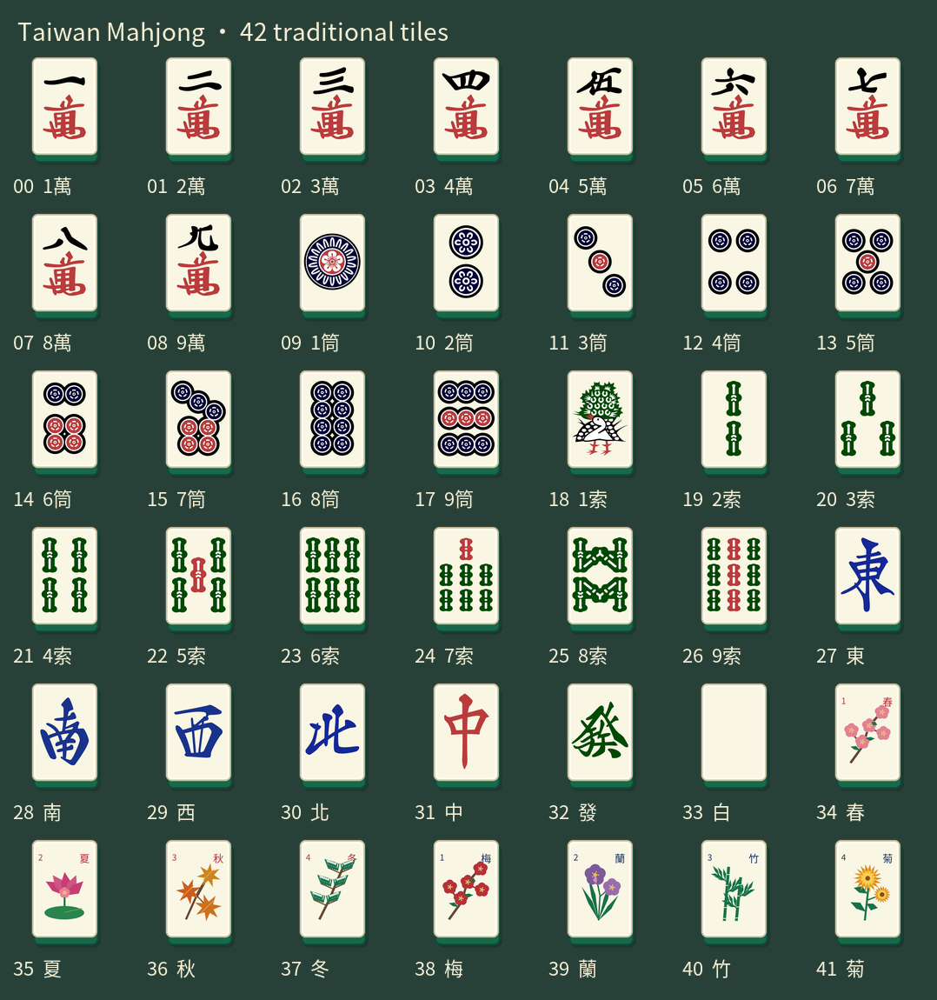

# TaiwanMahjong 台灣十六張麻將

<!-- ET_AUTHOR_SIGNATURE_START -->
<div align="center">
  <a href="https://www.instagram.com/182._.yiting/"></a>
  <p><strong>作者：ET</strong> &nbsp;·&nbsp; Instagram：<a href="https://www.instagram.com/182._.yiting/">@182._.yiting</a></p>
</div>
<!-- ET_AUTHOR_SIGNATURE_END -->

適用 **Paper 26.3 / Java 25** 的繁體中文麻將插件。玩家可圍坐在 3×3 立體牌桌，右鍵摸牌、出牌、吃、碰、槓、胡牌與自摸。支援免費補電腦，以及使用遊戲內鑽石結算的四人對局。

[下載插件與資源包](https://github.com/etetet94/TaiwanMahjong/releases) · [完整繁中玩法](docs/使用說明.txt) · [問題回報](https://github.com/etetet94/TaiwanMahjong/issues)



## 功能

- 台灣十六張規則、花牌補牌、吃碰槓、搶槓胡、一炮多響，以及聽牌提示。
- 42 種傳統圖片牌：萬、筒、索、東南西北、中發白與八張花牌。
- 自己的手牌僅傳送給本人；其他玩家與觀眾看到牌背。
- 手動摸牌、操作選單、聊天與畫面下方的回合提示。
- 1～4 位真人皆可免費練習；缺少的位置由電腦補齊。
- 四位真人可使用原版鑽石下注，預設底 5 顆、每台 2 顆、每人押金 5 顆。
- 帳本與付費牌局持久化；存領交易有回執、崩潰復原與重複結算保護。
- 先用押金、不足再用麻將帳戶餘額付款；兩者仍不足才把未付差額記欠債、排入天空競技場：挑戰兩隻伏守者，勝利清除欠債並獲得 64 顆鑽石；死亡也清債，保留裝備與經驗。支援觀眾席。
- 不需要客戶端模組；圖片牌面使用由伺服器提供的資源包。

這是台灣十六張規則，不包含日式立直、十四張七對子或國士無雙。實際台型與結算說明見 `/mj rules` 及 [玩法文件](docs/使用說明.txt)；各地家規不一定相同。

## 安裝

1. 準備 Paper 26.3 與 Java 25。
2. 從 Releases 下載 `TaiwanMahjong-1.1.3.jar`，放進伺服器的 `plugins/`。
3. 安裝下方資源包，然後正常啟動或重啟伺服器。
4. 輸入 `/mj list`，或右鍵牌桌空位入座。輸入 `/mj practice` 開始免費練習。

首次啟動預設會在出生點附近建立展示牌桌，並尋找空白高空區域建置競技場。競技場戰鬥場約 20×20，連同外圍與觀眾區需約 26×26；遇到已有建築會另找位置，無合適空間時拒絕施工。牌桌自動建立可由 `create-first-table` 關閉。

不依賴其他插件。GravesX、EliteMobs、ValhallaMMO 為可選整合；不隨本專案提供。

從舊版更新時，既有設定檔不會被覆蓋。若要使用 5 顆押金，請將 `plugins/TaiwanMahjong/config.yml` 的 `escrow-diamonds-per-player` 設為 `5`，再正常重啟。已開始的付費牌局保留其原押金，未結算牌局套用押金＋帳戶付款。已結算帳目與既有欠債不追溯重算。

### 讓玩家進服自動載入牌面

本插件不內建檔案託管服務。沒有其他資源包的伺服器，可在 `server.properties` 設定：

```properties
resource-pack=https://github.com/etetet94/TaiwanMahjong/releases/download/v1.1.1/TaiwanMahjong_resource_pack.zip
resource-pack-sha1=b6f0015eaf9d460713ef40bfd642aaa53e05665b
require-resource-pack=true
resource-pack-prompt={"text":"請接受資源包，以顯示傳統麻將圖片牌。"}
```

玩家加入時接受提示即可；拒絕必要資源包會無法加入。若已有其他資源包，請使用合併工具將本包的 `assets/taiwanmahjong/` 加入現有包，保留授權文件，重新託管並更新 SHA-1。不要直接用本包取代其他插件所需的資源。

資源包格式為 **97.1**；其他 Minecraft 版本尚未驗證。詳細內容與重建方式見 [resource-pack/README.md](resource-pack/README.md)。

## 常用指令

| 指令 | 用途 |
| --- | --- |
| `/mj` | 開啟操作選單 |
| `/mj list` | 查看牌桌 |
| `/mj join <牌桌名稱>` | 入座 |
| `/mj tp <牌桌名稱>` | 前往牌桌 |
| `/mj practice` 或 `/mj bots` | 免費開局，空位補電腦 |
| `/mj deposit <數量>` | 存入沒有自訂資料的原版鑽石 |
| `/mj balance` | 查看可領餘額 |
| `/mj withdraw <數量>` | 領回鑽石 |
| `/mj ready` | 準備四人鑽石對局 |
| `/mj leave` | 離開牌桌 |
| `/mj rules` | 查看玩法與台型 |
| `/mj arena watch` | 前往觀眾席 |
| `/mj arena leave` | 離開觀眾席 |
| `/mj create <牌桌名稱>` | 管理員建立牌桌 |
| `/mj remove <牌桌名稱>` | 管理員移除沒有進行中對局的牌桌 |

`taiwanmahjong.play` 預設所有玩家可用；`taiwanmahjong.admin` 預設僅 OP。沒有 VIP 限制。

## 建置與測試

需要 **JDK 25** 與 **Maven 3.9+**，不需要先安裝 Minecraft 伺服器：

```sh
mvn -B -ntp clean verify
```

產物為 `target/TaiwanMahjong-1.1.3.jar`。Paper API 僅作為編譯依賴，不會打包進插件。版本固定為 `26.3.build.200-stable`，設定方式依循 [Paper 專案建置文件](https://docs.papermc.io/paper/dev/project-setup/)。

Maven 會執行七組既有回歸測試，包括隨機牌局、手動摸牌、押金分配、帳本模型、崩潰復原、玩家檔回執與競技場欠債復原。測試資料使用臨時資料夾與虛構玩家識別碼。

重建資源包（Python 3.10+）：

```sh
python -m pip install -r resource-pack/requirements.txt
python tools/build-resource-pack.py
```

產物為 `resource-pack/dist/TaiwanMahjong_resource_pack.zip`。原圖及開放字型已隨附，建置不依賴私人伺服器或 Windows 系統字型。

GitHub Actions 在 Linux 與 Windows 編譯及測試 Java 程式，並在 Linux 重建資源包。這些自動測試不等同於多人客戶端的視覺與網路測試；正式使用前可先開免費練習局確認。

## 資料與升級

執行時資料位於 `plugins/TaiwanMahjong/`，包含牌桌、鑽石帳本、付費牌局及競技場紀錄。本專案沒有附帶任何玩家資料、伺服器地圖、連線憑證或其他插件程式。

請正常停止伺服器再更新 JAR，並把伺服器玩家資料與插件資料夾一起備份。不要在執行中刪除帳本，不要單獨還原舊帳本，也不要以 Bukkit `/reload` 或熱拔方式更新。免費練習局在重啟時結束；付費對局使用持久化復原。

## 授權

插件原始碼與文件採用 [MIT](LICENSE)。麻將圖案、花牌及字型有各自的授權，見 [第三方聲明](THIRD_PARTY_NOTICES.md) 與 [資源包授權](resource-pack/LICENSE.txt)。
